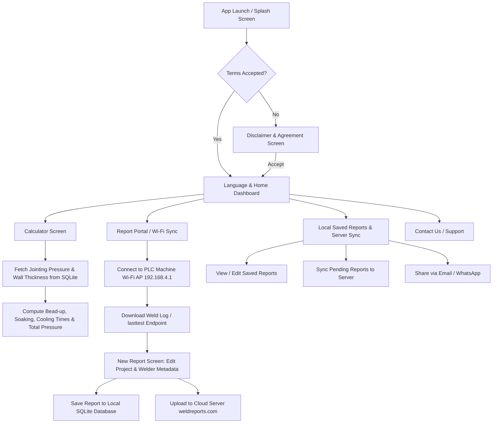
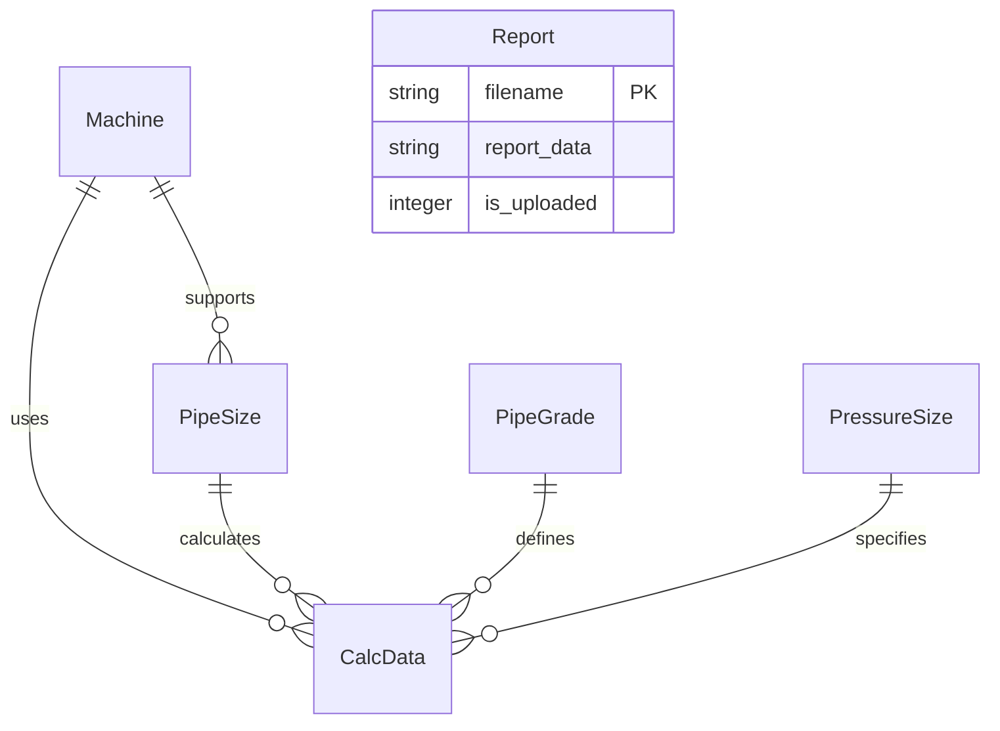

# LucidFusion - Detailed Project Explanation & Architecture Overview

## Executive Summary

**LucidFusion** (formerly known as Tejas Industries Pipe Fusion System) is an Android application designed for field engineers, quality control inspectors, and pipeline contractors working on High-Density Polyethylene (HDPE) and thermoplastic pipe butt-fusion welding projects.

The application serves two core purposes:
1. **Butt-Fusion Pressure & Timing Calculator:** Calculates precise welding parameters (heating plate temperature, jointing pressure, total welding pressure including drag pressure, bead-up time, soaking time, and cooling time) according to industrial pipe standards (e.g., IS 4984 and IS 4472).
2. **PLC Machine Data Integration & Weld Reporting System:** Connects wirelessly via Wi-Fi to PLC-enabled intelligent butt-fusion welding machines, pulls real-time and historical weld execution logs, allows offline modification of project metadata, stores records locally in an SQLite database, uploads completed reports to a remote cloud server (`weldreports.com`), and enables sharing reports via Email and WhatsApp.

---

## Technical Stack & Specifications

| Component | Technology / Library | Description |
| :--- | :--- | :--- |
| **Platform** | Android | Native Android application written in Java |
| **Architecture** | Single-Activity + Fragment Architecture | `MainActivity` acts as host, managing dynamic fragment navigation |
| **Local Database** | SQLite (`TejasjInd.db`) | Pre-populated database with dynamic schema upgrades via `DBAdapter` & `DBUpgrade` |
| **Networking** | `HttpURLConnection` & `WifiManager` | Local Wi-Fi connection to PLC welding machines (`192.168.4.1`) & remote HTTP API POST calls (`weldreports.com`) |
| **UI & Assets** | XML Layouts & TTF Fonts | Custom branding with embedded fonts (`BAUHS93.TTF`, `BROADW.TTF`) and bilingual support (English & Hindi) |
| **Async Operations** | `AsyncTask` & `Handler` | Background network requests, database lookups, and Wi-Fi connectivity monitoring |

---

## System Architecture & Flow



---

## Core Feature Modules & Use Cases

### 1. High-Density Polyethylene (HDPE) Welding Parameter Calculation
- **Selection Parameters:** Standard (IS 4984 / IS 4472), Machine Model (160mm up to 1200mm Intelligent Welders), Pipe Outer Diameter (50mm to 1200mm), Pipe Grade (PE 63, PE 80, PE 100), Pressure Rating (PN 2.5 to PN 25), and Drag Pressure ($kg/cm^2$).
- **Calculated Outputs:**
  - **Heating / Hot Plate Temperature:** Range determined by specification (e.g., $220 \pm 10^\circ\text{C}$).
  - **Jointing Pressure:** Hydraulic pressure fetched from the reference matrix in SQLite based on pipe specification.
  - **Total Welding Pressure:** $\text{Jointing Pressure} + \text{Drag Pressure}$.
  - **Bead-up Time ($T_1$):** Initial heating phase under pressure to form the bead.
  - **Soaking Time ($T_2$):** Heat soaking phase at zero/minimal pressure.
  - **Cooling Time ($T_5$):** Cooling phase under full jointing pressure.

### 2. Wi-Fi Machine Data Retrieval (PLC Integration)
- Connects directly to the welding machine's Wi-Fi access point (AP) using configurable SSID and Password.
- Fetches real-time log data from local endpoint `http://192.168.4.1/lasttest` or date-filtered endpoints `http://192.168.4.1/From{Date}To{Date}`.
- Parses incoming JSON payload from the PLC unit containing machine ID, weld number, timestamp, achieved drag pressure, achieved joint pressure, hot plate temperature, and phase timers ($T_1, T_2, T_3, T_5$).

### 3. Weld Report Management & Editing
- Combines machine execution data with human-entered metadata:
  - Company Name
  - Welder Name
  - Project Name
  - Site Location
  - SDR & Pipe Length
  - Inspector / Operator Comments
- Supports offline saving into local SQLite storage table `Report`.

### 4. Cloud Synchronization & Remote Server Integration
- Uploads complete weld reports to remote backend:
  `https://weldreports.com/api.php?request=addreportdata&PLCNumber=...&FileName=...`
- Tracks upload status with local column `is_uploaded` (1 = Uploaded, 0 = Pending).
- Provides status icons in the UI (`ic_cab_done_mtrl_alpha` for completed, `stat_sys_upload_anim0` for pending).

### 5. Multi-Language Support (English & Hindi)
- Supports field workers who prefer vernacular instructions.
- All labels, dialogs, button captions, and metric units dynamically update based on preference settings stored in `SharedPreferences`.

---

## Database Architecture (`TejasjInd.db`)

The SQLite database contains reference engineering tables for pipe specifications as well as a user-generated report table:



### Table Definitions
1. **`Machine`**: Lists supported welding machine models (e.g., 160 Intelligent Welder, 250, 315, 450, 630, 800, 1000, 1200) and standard standard classifications (IS 4984 / IS 4472).
2. **`PipeSize`**: Outer diameters associated with each machine model.
3. **`PipeGrade`**: Raw material specifications (PE 63, PE 80, PE 100).
4. **`PressureSize`**: Nominal pressure ratings (PN 2.5, PN 4, PN 6, PN 8, PN 10, PN 12.5, PN 16, PN 20, PN 25).
5. **`CalcData`**: Reference matrix containing standard base temperatures, jointing pressures, and average wall thicknesses for every combination of Machine, Pipe Size, Pipe Grade, and Pressure Rating.
6. **`Report`**: Stores local weld execution logs as JSON strings keyed by unique filename (`_FILENAME`).

---

## Detailed Directory & Package Structure

```
LucidFusion-main/
├── app/
│   ├── src/
│   │   └── main/
│   │       ├── AndroidManifest.xml          # App permissions & Activity declaration
│   │       ├── assets/                      # Pre-populated TejasjInd.db & font files (BAUHS93.TTF, BROADW.TTF)
│   │       ├── java/com/org/lucidfusion/
│   │       │   ├── AppCostants.java         # Constant keys, API endpoints, SparseArrays
│   │       │   ├── ApplicationClass.java    # Application subclass initializing SQLite singleton
│   │       │   ├── MainActivity.java        # Single activity container & permission dispatcher
│   │       │   ├── Utils.java               # Network helper, math formulas, share intent builders
│   │       │   ├── adapters/                # Custom Spinner adapters for Machine, Grade, Size, Pressure
│   │       │   ├── dbhelper/                # DBAdapter, DBQueries, DBUpgrade, DBProvider, DBConstant
│   │       │   ├── dtos/                    # DTO classes: CalcData, MachineModel, PipeGrade, PipeSize, PressureSize, ReportDTO
│   │       │   └── fragment/                # UI Fragments (Calculation, Report, NewReport, PastReport, SendToServer, etc.)
│   │       └── res/                         # Strings (EN/HI), Layout XMLs, Animations, Drawables
└── document/
    └── project_explanation.md               # Detailed project explanation & architectural document
```

---

## Important Mathematical Formulas Used

In `com.org.lucidfusion.Utils` and `CalculationFragment`:

1. **Bead-Up Time ($T_1$):**
   $$\text{BeadUpTime} = \frac{6 \times \text{Average Thickness}}{\text{Divider}}$$
   *(Divider is 1 for Machine IDs 1/7, or 60 for minutes calculation on other models)*

2. **Soaking Time ($T_2$):**
   $$\text{SoakingTime} = \frac{15 \times \text{Average Thickness}}{\text{Divider}}$$

3. **Cooling Time ($T_5$):**
   $$\text{CoolingTime} = 1.5 \times \text{Average Thickness} \quad (\text{minutes})$$

4. **Total Welding Hydraulic Pressure:**
   $$\text{Welding Pressure} = \text{Jointing Pressure (from DB)} + \text{Drag Pressure (input by operator)}$$

---

## Summary of Key Source Code Files

- **[MainActivity.java](file:///c:/Users/Devstree/Desktop/Ankur/Android%20Project/LucidFusion-main/app/src/main/java/com/org/lucidfusion/MainActivity.java)**: Core Activity managing fragment switching, database loading, runtime location permissions, and clipboard copy functions.
- **[Utils.java](file:///c:/Users/Devstree/Desktop/Ankur/Android%20Project/LucidFusion-main/app/src/main/java/com/org/lucidfusion/Utils.java)**: Contains network tasks (`SendDataToServer`), sharing helpers (`shareOnWhatsapp`, `shareOnMail`), and welding math utilities.
- **[CalculationFragment.java](file:///c:/Users/Devstree/Desktop/Ankur/Android%20Project/LucidFusion-main/app/src/main/java/com/org/lucidfusion/fragment/CalculationFragment.java)**: Interactive form for calculating welding pressures, heating temperatures, and timers.
- **[FragmentReport.java](file:///c:/Users/Devstree/Desktop/Ankur/Android%20Project/LucidFusion-main/app/src/main/java/com/org/lucidfusion/fragment/FragmentReport.java)**: Wi-Fi manager connecting to the PLC welding machine access point (`192.168.4.1`).
- **[FragmentNewReport.java](file:///c:/Users/Devstree/Desktop/Ankur/Android%20Project/LucidFusion-main/app/src/main/java/com/org/lucidfusion/fragment/FragmentNewReport.java)**: Form for reviewing and updating weld details downloaded from the PLC welder.
- **[FragmentSendToServer.java](file:///c:/Users/Devstree/Desktop/Ankur/Android%20Project/LucidFusion-main/app/src/main/java/com/org/lucidfusion/fragment/FragmentSendToServer.java)**: Offline queue viewer showing upload status of stored reports and triggering cloud sync.
- **[DBAdapter.java](file:///c:/Users/Devstree/Desktop/Ankur/Android%20Project/LucidFusion-main/app/src/main/java/com/org/lucidfusion/dbhelper/DBAdapter.java)** & **[DBQueries.java](file:///c:/Users/Devstree/Desktop/Ankur/Android%20Project/LucidFusion-main/app/src/main/java/com/org/lucidfusion/dbhelper/DBQueries.java)**: SQLite database handlers for reading lookup tables and persisting user weld reports.
